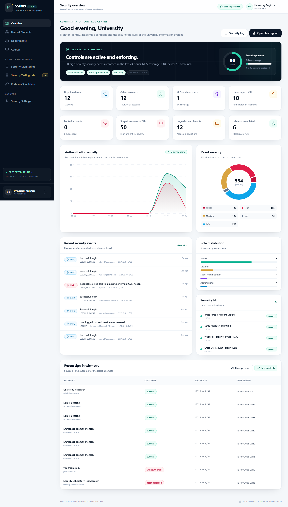
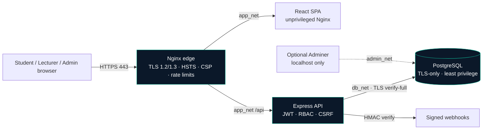

# SSIMS — Secure Student Information Management System

A full-stack, security-focused university information system built to demonstrate practical cybersecurity controls rather than a static prototype. Administrators manage identities and academic structure, lecturers grade only their assigned students, and students access only their own record. Every sensitive action is authorised by the API and written to an append-only audit trail.



## What is included

| Layer | Implementation |
|---|---|
| Frontend | React 18, TypeScript, Tailwind CSS, Vite, Recharts, responsive role dashboards |
| Backend | Node.js 22, Express, TypeScript, REST API, Zod validation |
| Database | PostgreSQL 16+, parameterised queries, least-privilege roles, TLS, audit triggers |
| Identity | Argon2id passwords, TOTP MFA + backup codes, JWT access tokens, rotating refresh sessions |
| Web security | Server-side RBAC, CSRF double-submit tokens, XSS sanitisation, strict CSP, HSTS, rate limiting |
| Integrations | HMAC-SHA256 webhooks with timestamp and replay protection, simulated Kerberos exchange |
| Infrastructure | Docker Compose, Nginx edge proxy, self-signed local CA, segmented Docker networks, firewall guide |
| Assurance | Security Testing Lab, seedable demo data, 12 unit tests, 41-check security suite, 41-check functional suite, 29-check UI suite |

## Quick start with Docker

### Prerequisites

- Docker Desktop / Docker Engine with Compose v2
- OpenSSL is **not** required on the host: the `cert-init` container generates the local CA and certificates

### 1. Generate environment secrets

```bash
# Linux/macOS
chmod +x scripts/*.sh
./scripts/generate-env.sh

# Windows PowerShell
powershell -ExecutionPolicy Bypass -File scripts/generate-env.ps1
```

The generator creates a `.env` with random database passwords, JWT/CSRF/MFA/HMAC secrets and random bootstrap account passwords. It prints the bootstrap credentials once. You can inspect `.env` later; it is gitignored and permission-restricted on Linux.

> Do not use `.env.example` values directly. Compose uses `${VAR:?}` checks so missing secrets fail closed.

### 2. Launch

```bash
docker compose up --build
```

This starts the following services:

1. `cert-init` — creates the local CA, web certificate and PostgreSQL certificate.
2. `db` — PostgreSQL with TLS-only TCP access and a restricted `pg_hba.conf`.
3. `migrate` — applies schema migrations, grants least-privilege permissions and seeds demo data.
4. `backend` — production API container, listening only on internal `app_net`/`db_net` and mounting only the database CA certificate (never the server key).
5. `frontend` — the compiled React SPA served by an unprivileged Nginx container.
6. `nginx` — the only published service; HTTP redirects to HTTPS and `/api` is reverse-proxied.

Open **https://localhost**.

The certificate is signed by a local development CA. Either accept the browser warning for the self-signed chain or import the generated CA:

```text
infra/certs/generated/ssims-local-ca.crt
```

Use `https://localhost` (not `https://127.0.0.1`) so the browser Origin matches `PUBLIC_ORIGIN` and the API accepts the CSRF-protected requests.

### 3. Sign in

Use the bootstrap accounts printed by the generator:

| Role | Email |
|---|---|
| Super Administrator | `superadmin@ssims.edu` |
| Administrator | `admin@ssims.edu` |
| Lecturer | `lecturer@ssims.edu` |
| Student | `student@ssims.edu` |
| Isolated Security Lab target | `security.lab@ssims.edu` |

Passwords are the `SEED_*_PASSWORD` values in `.env`. **Change every bootstrap password after first sign-in.** Newly created accounts and temporary passwords are forced to change at first login.

### 4. Optional database administration

The database has no published port. An optional Adminer profile is attached only to the internal admin network and bound to localhost:

```bash
docker compose --profile admin up -d adminer
# http://127.0.0.1:8080
```

Configure Adminer's connection to use SSL (`sslmode=require`) because `hostnossl` is rejected by PostgreSQL.

### Stop and reset

```bash
docker compose down            # stop, keep database volume
docker compose down -v         # DESTROY database, certificates and all demo data
```

## Local development (without Docker)

### Prerequisites

- Node.js 22+
- pnpm 11 (`corepack enable`)
- PostgreSQL 16+ running locally

### 1. Create the local database and roles

Connect as the PostgreSQL superuser and run:

```sql
CREATE ROLE ssims_owner LOGIN NOSUPERUSER NOCREATEDB NOCREATEROLE NOINHERIT PASSWORD 'replace-owner-password';
CREATE ROLE ssims_app   LOGIN NOSUPERUSER NOCREATEDB NOCREATEROLE NOINHERIT PASSWORD 'replace-app-password';
CREATE ROLE ssims_readonly LOGIN NOSUPERUSER NOCREATEDB NOCREATEROLE NOINHERIT PASSWORD 'replace-readonly-password';
CREATE DATABASE ssims OWNER ssims_owner;
```

Edit `.env` so that:

- `DATABASE_ADMIN_URL` uses `ssims_owner`
- `DATABASE_URL` uses `ssims_app`
- `DB_SSL_MODE=disable` if your local PostgreSQL is not configured for TLS
- `FRONTEND_ORIGIN=http://localhost:5173`
- `COOKIE_SECURE=false` and `TRUST_PROXY=0` for plain local HTTP

Then:

```bash
pnpm install
pnpm migrate
pnpm seed
pnpm dev:backend     # terminal 1: http://127.0.0.1:4000
pnpm dev:frontend    # terminal 2: http://localhost:5173
```

The Vite development server proxies `/api` to `127.0.0.1:4000`, preserving same-origin cookies and CSRF semantics.

The local database may be started in TLS mode too; set `DB_SSL_MODE=verify-full`, `DB_SSL_CA` and `DB_SSL_SERVERNAME` to match your certificate.

## Initial administrator setup

In Docker, `migrate` automatically applies `database/migrations/*.sql` and the idempotent seed. For a fresh non-Docker installation:

```bash
pnpm migrate
pnpm seed
```

The seed is idempotent. It creates:

- 5 departments (Computer Science, IT, Business, Engineering, Health Sciences)
- 6 courses with assigned lecturers
- 1 super administrator, 1 administrator, 2 lecturers and 6 students
- enrollment and grade records so dashboards are populated
- an isolated `security.lab@ssims.edu` target for the brute-force exercise

Change bootstrap passwords immediately. The UI warns when `must_change_password` is set, and the API enforces the current password policy on every password change.

## Repository structure

```text
ssims/
├── backend/                 Express + TypeScript API
│   ├── src/config/          Fail-closed environment validation
│   ├── src/db/              Connection pool, TLS, migration runner
│   ├── src/middleware/      Auth, RBAC, CSRF, rate limiting, IP rules, headers
│   ├── src/routes/          REST endpoints
│   ├── src/services/        Auth, MFA, audit, webhooks, lab, Kerberos
│   ├── src/utils/           Argon2id policy, TOTP, AES-GCM, logging, validation
│   └── tests/               Security unit tests
├── frontend/                React + TypeScript + Tailwind SPA
│   ├── src/pages/           Auth, admin, lecturer, student, settings
│   ├── src/components/      Design system and reusable UI
│   └── src/api/             In-memory JWT client + CSRF + refresh rotation
├── database/migrations/     Schema, triggers, grants, immutability rules
├── database/init/           Docker bootstrap roles
├── infra/nginx/             Edge reverse proxy, CSP, HSTS, rate limits
├── infra/postgres/          TLS-only HBA and database image
├── infra/certs/             Local CA/certificate generator
├── scripts/                 Env generation, E2E, UI verification, backups, firewall
├── docs/                    Full academic report and security documentation
└── docker-compose.yml       Segmented production-style deployment
```

## Security architecture



### Security highlights

- **Passwords**: Argon2id (19 MiB, t=2, p=1), 12+ characters, four character classes, compromised-pattern denylist, reuse prevention using Argon2 history, and single-use hashed reset tokens.
- **MFA**: RFC 6238 TOTP, QR enrollment, AES-256-GCM encrypted secrets, replay-resistant time steps, 10 HMAC-hashed single-use recovery codes.
- **Sessions**: 15-minute access JWT held only in memory; opaque refresh token in an `HttpOnly`, `Secure`, `SameSite=Strict` cookie scoped to `/api/auth`; refresh rotation with reuse detection and full-family revocation; idle and absolute expiry; password changes revoke all sessions; temporary/bootstrap accounts are API-restricted to forced password change.
- **Authorisation**: Roles `super_admin`, `administrator`, `lecturer`, `student`. Every private route checks a live session and current database role. Lecturers are data-scoped to their assigned courses; students to their own records.
- **CSRF**: HMAC-signed double-submit token plus Origin validation and custom header comparison. Applied to every state-changing authenticated API route.
- **Injection**: All SQL is parameterised (`$1`, `$2`, …). Inputs are validated with Zod and sanitised. No raw SQL interpolation.
- **XSS**: Server-side sanitisation, React escaping, no `dangerouslySetInnerHTML`, strict CSP at the edge, `X-Content-Type-Options`, frame denial.
- **Database**: Separate `ssims_owner` (migrations), `ssims_app` (runtime DML only), `ssims_readonly`; no SUPERUSER/CREATEDB/CREATEROLE; no DDL from the API; TLS-only host connections; append-only audit tables protected by privileges and triggers.
- **Brute force**: Per-IP login limiter, account failure counters, progressive human-verification challenge, temporary lockout, login attempt audit table.
- **Webhooks**: HMAC-SHA256 over timestamp + event ID + raw body, 300-second tolerance, constant-time comparison, unique event IDs, rejected-event audit records. Secret never reaches the browser.
- **Transport**: HTTP redirects to HTTPS at Nginx; HSTS; TLS 1.2/1.3; API→PostgreSQL uses TLS with `verify-full` and a project CA.
- **Monitoring**: Immutable security events, login telemetry, database row audit, filters, CSV export with spreadsheet-formula hardening, administrator-only dashboard.

See [docs/SECURITY-MECHANISMS.md](docs/SECURITY-MECHANISMS.md) for file-level implementation details and [docs/SSIMS-Project-Report.md](docs/SSIMS-Project-Report.md) for the complete academic report.

## Security Testing Lab

Sign in as an administrator and open **Security Testing Lab**. The lab runs eight real, low-volume exercises against this local deployment:

1. SQL injection (parameterised query)
2. Brute force and account lockout (isolated lab account)
3. XSS payload neutralisation
4. Unauthorized access / RBAC (ephemeral student token calls an admin endpoint)
5. MITM / transport-security evidence
6. CSRF rejection
7. Forged webhook HMAC rejection
8. Controlled DDoS / request throttling (12 local probe requests)

Each run records: description, procedure, expected result, actual result, responsible mechanism, structured evidence, actor and timestamp in the append-only `security_test_runs` table.

> **Authorized local testing only.** These tests must never be pointed at third-party systems. The brute-force exercise intentionally leaves its isolated target locked as evidence; use **Reset lab account** to restore it.

## Verification commands

Start the API first, then:

```bash
pnpm test                 # 12 security unit tests
pnpm test:e2e             # 41-check live API/security suite (requires API :4000 and .env)
pnpm test:functional      # 41-check CRUD/RBAC/password-reset suite
pnpm test:ui              # 29-check headless Edge suite + screenshots (requires Vite :5173)
pnpm audit --prod         # production dependency advisory check
```

The UI suite uses `playwright-core` with an installed Microsoft Edge/Chromium. Screenshots are written to `artifacts/screenshots/`.

Manual database checks:

```bash
# API role cannot mutate audit logs or create tables
psql "$DATABASE_URL" -c "UPDATE security_events SET description='x';"   # permission denied
psql "$DATABASE_URL" -c "CREATE TABLE should_fail(id int);"             # permission denied
psql "$DATABASE_URL" -c "SELECT current_user, rolsuper FROM pg_roles WHERE rolname=current_user;"
```

## Webhook signing example

The signing secret is server-side only. From a trusted backend shell:

```bash
TIMESTAMP=$(date +%s)
EVENT_ID="evt-$(uuidgen)"
BODY='{"event":"grade.published","course":"CS205"}'
SIGNATURE=$(printf '%s.%s.%s' "$TIMESTAMP" "$EVENT_ID" "$BODY" | openssl dgst -sha256 -hmac "$WEBHOOK_SECRET" -hex | awk '{print $2}')

curl -sS http://127.0.0.1:4000/api/webhooks/security \
  -H "Content-Type: application/json" \
  -H "X-SSIMS-Event-Id: $EVENT_ID" \
  -H "X-SSIMS-Timestamp: $TIMESTAMP" \
  -H "X-SSIMS-Event-Type: grade.published" \
  -H "X-SSIMS-Signature: $SIGNATURE" \
  --data-binary "$BODY"
```

The same event ID replayed returns HTTP 409. A body/signature mismatch returns HTTP 401.

## Database backup

```bash
./scripts/backup-db.sh
./scripts/restore-db.sh backups/ssims-<timestamp>.dump
```

See [docs/DATABASE-BACKUP-RECOVERY.md](docs/DATABASE-BACKUP-RECOVERY.md) for encryption, retention, off-site storage and recovery drills.

## Documentation

- [Full project report](docs/SSIMS-Project-Report.md)
- [Complete test results](docs/SECURITY-TEST-RESULTS.md) with 12 unit, 41 security, 41 functional and 29 UI checks
- [Implemented security mechanisms](docs/SECURITY-MECHANISMS.md)
- [Security test procedures and actual results](docs/SECURITY-TEST-RESULTS.md)
- [Kerberos simulation distinction](docs/KERBEROS-SIMULATION.md)
- [Firewall, network segmentation and DDoS](docs/FIREWALL-NETWORK.md)
- [Database backup and recovery](docs/DATABASE-BACKUP-RECOVERY.md)
- [API reference](docs/API.md)

## Limitations

- The local CA is for development/academic demonstration only. Production must use a publicly trusted certificate and automated renewal.
- Reset links are printed only in development (`EXPOSE_RESET_TOKEN=true`) because no SMTP provider is configured. Production sets this to `false`; integrate an email provider and deliver the token out of band.
- In-memory rate limits and sessions assume a single API instance. Multi-replica deployments need Redis-backed rate limiting and session/revocation coordination.
- Kerberos is a clearly labelled in-process simulation, not a KDC.
- Docker Compose is a single-host academic deployment; production needs orchestration, external secret management, WAF/DDoS scrubbing, central logging and managed database backups.
- The lab's DDoS test is intentionally low-volume and demonstrates application/edge throttling, not mitigation of a volumetric attack.
- Docker Compose was configuration-validated but not started in the verification environment because Docker was unavailable; see the test results for the exact boundary.

## Authorized use

This project is an academic demonstration. Run attack simulations only against your own local SSIMS deployment. Do not use the payloads, brute-force routine or testing endpoints against systems you do not own or have explicit written permission to test.
