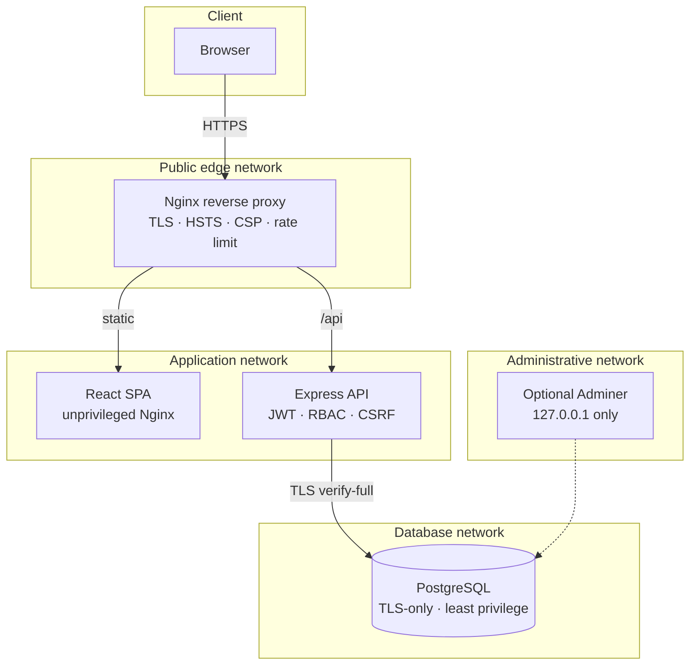
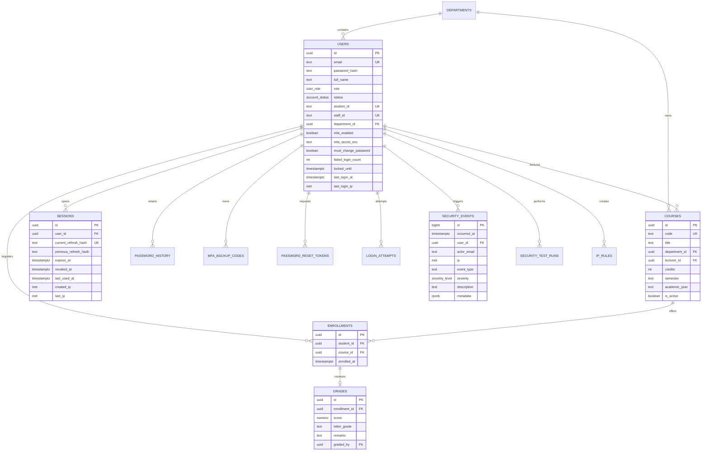

# Secure Student Information Management System (SSIMS)

**Project Report**

| Item | Detail |
|---|---|
| Project | Secure Student Information Management System |
| Institution | SSIMS University |
| Domain | Web application security, identity and access management, secure infrastructure |
| Stack | React · TypeScript · Tailwind CSS · Node.js · Express · PostgreSQL · Nginx · Docker |
| Report date | 11 November 2026 |
| Source repository | `ssims/` |

---

## Abstract

SSIMS is a working university student information system designed around a single principle: sensitive academic records must be protected by enforceable technical controls, not by hiding buttons in a user interface. The system separates the public, application, database and administrative network zones; delivers a React/TypeScript dashboard through an HTTPS Nginx edge; exposes a REST API implemented with Express; and persists all data in PostgreSQL through parameterised queries and a least-privilege application role.

The project implements Argon2id password hashing, TOTP multi-factor authentication with recovery codes, short-lived JWT access tokens, rotating refresh sessions with reuse detection, server-side role-based access control, CSRF double-submit protection, rate limiting, progressive login verification, account lockout, signed webhooks, encrypted database connections, immutable audit records and a dedicated Security Testing Lab. It also includes a clearly labelled Kerberos authentication simulation that demonstrates TGT, service ticket, authenticator and mutual-authentication exchanges without pretending to interoperate with a real KDC.

The completed application was verified against a live PostgreSQL instance and a live API. Twelve unit tests, forty-one end-to-end security checks, forty-one functional workflow checks and twenty-nine headless browser checks passed. Three database-level negative tests confirmed that the runtime role cannot mutate security logs or create schema objects. Eight attack demonstrations were executed through the Security Testing Lab and produced append-only evidence. A production dependency audit reported no known vulnerabilities after upgrading Zod and React Router.

---

## 1. Introduction

### 1.1 Background

Universities hold some of the most sensitive records in an educational institution: identity information, contact details, enrollment history, grades and staff assignments. These records are valuable to attackers because they support identity fraud, credential theft, grade manipulation and extortion. At the same time, academic systems are often built as web applications with many user populations, delegated responsibilities and complex access rules.

A student information management system must answer four questions for every request:

1. **Who is making the request?** — authentication.
2. **What is that identity allowed to do?** — authorization.
3. **Can the request be trusted?** — session, CSRF, origin and input integrity.
4. **What happened afterwards?** — auditability and monitoring.

SSIMS implements these questions as code and database constraints.

### 1.2 Purpose

The project demonstrates how a small organisation can design, build, deploy and secure a realistic information system. It is not a mock-up: authentication, persistence, role enforcement, MFA, audit logging, database restrictions, webhook verification, rate limiting and the security exercises all execute against a live database and API.

### 1.3 Scope

The application includes:

- administrator, lecturer and student experiences;
- account, department, course, enrollment and grade management;
- a security operations dashboard with event filters and audit views;
- a Security Testing Lab containing eight controlled attack simulations;
- an educational Kerberos protocol simulation;
- a Docker Compose deployment with Nginx, TLS, PostgreSQL and network segmentation;
- deployment, backup, firewall and testing documentation.

The system is an academic demonstration. It is not presented as a production-certified student records platform, and it does not integrate with a real identity provider or payment system.

### 1.4 Definitions

| Term | Meaning in this report |
|---|---|
| TGT | Ticket Granting Ticket — a Kerberos ticket used to obtain service tickets (simulated here). |
| TOTP | Time-based One-Time Password, RFC 6238. |
| RBAC | Role-Based Access Control. |
| CSRF | Cross-Site Request Forgery. |
| HSTS | HTTP Strict Transport Security. |
| MITM | Man-in-the-Middle. |
| RLS | Row-Level Security (not used; authorization is enforced in the API). |
| DDoS | Distributed Denial of Service. |

---

## 2. Problem Statement

### 2.1 The security problem

A naive student information system might:

- store plaintext or weakly hashed passwords;
- issue long-lived bearer tokens stored in `localStorage`;
- enforce roles only by hiding navigation links;
- concatenate user input into SQL strings;
- trust any request that carries a cookie;
- allow lecturers to inspect any student record;
- write security logs that administrators can delete;
- expose PostgreSQL to the host network;
- use a single application database account with full ownership;
- treat documentation as a substitute for working controls.

Any one of these failures can lead to credential compromise, horizontal or vertical privilege escalation, data exfiltration, grade tampering or an inability to investigate an incident.

### 2.2 The project problem

The project must deliver a **working** secured information system that demonstrates practical controls across the browser, API, database and infrastructure, while remaining understandable enough for an academic defence. The system must show not only that attacks fail, but **why** they fail, with evidence recorded at the time of the attempt.

### 2.3 Assumptions and constraints

- The deployment target is a single Linux host running Docker Compose for demonstration.
- The local project cannot operate a real Kerberos KDC, so the Kerberos requirement is satisfied by a clearly separated simulation.
- No SMTP provider is available in the local environment. Password reset tokens are therefore exposed only when `EXPOSE_RESET_TOKEN=true` in development. Production mode rejects that setting.
- The Security Testing Lab is authorized only against the local instance.

---

## 3. Objectives

### 3.1 General objective

Build a functional, security-focused student information management system that enforces authentication, authorization, session integrity, input safety and auditability through real backend and database logic.

### 3.2 Specific objectives

1. Establish a normalised PostgreSQL schema for departments, users, courses, enrollments, grades, sessions and security records.
2. Implement secure registration, login, MFA, refresh, logout, password reset and password change flows.
3. Enforce four roles and data-scoped access on the server for every private endpoint.
4. Implement web application defences against SQL injection, XSS, CSRF, brute force and session theft.
5. Apply least-privilege database roles, TLS database connections and append-only audit records.
6. Provide an administrator security dashboard with filters, metrics and evidence.
7. Build a Security Testing Lab that demonstrably exercises eight attack classes.
8. Demonstrate Kerberos concepts while clearly distinguishing simulation from real Kerberos.
9. Containerise the system with Nginx, Docker Compose, TLS and segmented networks.
10. Document installation, operation, security design, testing and limitations.

---

## 4. Functional Requirements

### 4.1 Administrator requirements

| ID | Requirement | Implementation |
|---|---|---|
| FR-A1 | Create and manage student accounts | `POST/PATCH /api/admin/users`, user management UI |
| FR-A2 | Register lecturers and staff | Role-aware creation form; only super administrators can create administrative accounts |
| FR-A3 | Assign roles and permissions | Role changes with audit event; permission matrix per role |
| FR-A4 | View student records | Account detail modal with enrollments and grades |
| FR-A5 | Manage courses and departments | CRUD APIs and management pages |
| FR-A6 | View security logs and suspicious activity | Event dashboard, filters, severity, IP, actor, metadata |
| FR-A7 | Manage restrictions and access policies | Account lock/suspend/unlock, security policy editor, IP allow/deny rules |
| FR-A8 | Review laboratory evidence | Append-only test run ledger and per-test evidence viewer |

### 4.2 Lecturer requirements

| ID | Requirement | Implementation |
|---|---|---|
| FR-L1 | Log in securely | Password + optional MFA, rotating refresh session |
| FR-L2 | View assigned courses | SQL scoped by `lecturer_id` |
| FR-L3 | Add and update student grades | Grade upsert restricted to the lecturer's own course |
| FR-L4 | View student academic records | Only results from courses assigned to that lecturer |
| FR-L5 | Access only authorized student information | Every lecturer query includes lecturer ownership; the API returns 403 otherwise |

### 4.3 Student requirements

| ID | Requirement | Implementation |
|---|---|---|
| FR-S1 | Register and log in | Public student-only registration; secure login |
| FR-S2 | View personal information | `/auth/me` and profile page |
| FR-S3 | View registered courses and results | Student-owned enrollment/result queries |
| FR-S4 | Update permitted profile information | Only phone and address through `/student/profile` |
| FR-S5 | Change password and manage MFA | Password change, TOTP setup, backup codes, MFA disable |

### 4.4 Cross-cutting requirements

- Session expiration and revocation.
- Password reset without account enumeration.
- Security event and login attempt recording.
- CSV export of filtered security events.
- Webhook receiver with verified signatures.
- Search, filtering, pagination, modals, loading and error states.
- Responsive desktop and mobile layouts.

---

## 5. Non-Functional Requirements

| ID | Category | Requirement | Evidence |
|---|---|---|---|
| NFR-1 | Security | No plaintext passwords or secrets in storage | Argon2id hashes; AES-256-GCM for TOTP secrets; hashed reset/refresh/backup tokens |
| NFR-2 | Security | Authorization enforced server-side | Student token against `/api/admin/users` returned HTTP 403 in tests |
| NFR-3 | Integrity | Security logs are append-only | Runtime role denied UPDATE/DELETE; triggers block mutation |
| NFR-4 | Confidentiality | TLS for client and database traffic | Nginx HTTPS configuration; PostgreSQL TLS-only HBA; `verify-full` API client |
| NFR-5 | Availability | Rate limiting and connection limits | Express limiters, Nginx `limit_req`/`limit_conn`, account lockout |
| NFR-6 | Auditability | Sensitive actions carry actor, time, IP, type and severity | `security_events`, `audit_log`, `login_attempts`, `webhook_events` |
| NFR-7 | Usability | Professional, responsive interface | 29-check headless UI suite; desktop/mobile screenshots |
| NFR-8 | Maintainability | Typed frontend/backend, separated components | TypeScript strict builds; service/route/middleware layers |
| NFR-9 | Portability | One-command container deployment | `docker compose up --build` |
| NFR-10 | Operability | Health checks and restart policies | Compose health checks, `restart: unless-stopped` |
| NFR-11 | Recoverability | Database backup and restore | `pg_dump` scripts and documented drill |
| NFR-12 | Privacy | Do not log passwords/tokens/secrets | Pino redaction, audit metadata filtering, no request bodies in logs |

---

## 6. System Architecture

### 6.1 Logical architecture



### 6.2 Component responsibilities

| Component | Responsibility | Trust boundary |
|---|---|---|
| React SPA | Presentation, forms, client-side validation, role-specific navigation | Untrusted input; never trusted for authorization |
| Nginx edge | TLS termination, HTTP redirect, security headers, rate and connection limits | Public-facing |
| Express API | Authentication, authorization, validation, business logic, audit events | Trusted application code |
| PostgreSQL | Persistence, constraints, triggers, least-privilege roles, audit records | Trusted, not publicly reachable |
| cert-init | Generates local CA, web certificate and database certificate | Offline build-time helper |
| Migration service | Schema migrations and idempotent seed using the owner role | Temporary, exits after completion |
| Adminer | Optional database UI on localhost-only administrative network | Highly privileged; disabled by default |

### 6.3 Request flow

1. Browser obtains the SPA over HTTPS from Nginx.
2. SPA posts credentials to `/api/auth/login`.
3. API verifies Argon2id password, optional TOTP, account status and policy.
4. API creates a server-side session, stores a keyed hash of the refresh token, returns a short-lived access JWT in JSON and sets an HttpOnly refresh cookie plus a readable signed CSRF cookie.
5. The SPA keeps the access token only in memory and sends it as a Bearer token on API calls.
6. The API verifies the JWT, checks the live session and account status in PostgreSQL, then checks role permissions.
7. State-changing requests must carry the CSRF header matching the signed cookie and a trusted Origin.
8. The API writes both a high-level security event and, for sensitive row changes, a database audit record.
9. Nginx never proxies directly to PostgreSQL.

### 6.4 Why authorization is not a frontend concern

The frontend hides navigation that a role cannot use, but that is a usability feature. The authoritative checks live in:

- `authenticate` — verifies token, live session, account status, idle timeout and MFA policy;
- `requireRoles` / `requirePermission` — checks the current database role and permission matrix;
- route-level SQL scoping — e.g. lecturer queries always include `c.lecturer_id = $n`.

A student can edit JavaScript, replay requests or call the API directly; the database query and role guard still deny access.

---

## 7. Network Architecture

### 7.1 Zones

| Zone | Docker network | Members | Exposure |
|---|---|---|---|
| Public edge | `edge_net` | Nginx | Host ports 80/443 only |
| Application | `app_net` (internal) | Nginx, frontend, API | No host ports |
| Database | `db_net` (internal) | API, migration, PostgreSQL | No host ports |
| Administration | `admin_net` (internal) | PostgreSQL, optional Adminer | Adminer bound to `127.0.0.1` only |

### 7.2 Ports

| Service | Container port | Host exposure | Allowed sources |
|---|---|---|---|
| Nginx | 8080 (HTTP), 8443 (HTTPS) | 80, 443 | Internet |
| Frontend | 8080 | None | Nginx only |
| API | 4000 | None | Nginx only (and loopback self-tests inside the API container) |
| PostgreSQL | 5432 | None | API/migration over TLS; Adminer on admin network |
| Adminer (profile) | 8080 | `127.0.0.1:8080` | Local administrator only |

### 7.3 Database access control

- PostgreSQL listens on the container network only.
- `pg_hba.conf` allows `hostssl` with `scram-sha-256`; `hostnossl` is explicitly rejected.
- The unix socket is available only inside the database container for health checks, backup and maintenance.
- The API connects as `ssims_app`, not as the schema owner or PostgreSQL superuser.
- `DB_SSL_MODE=verify-full` validates the CA and the `db` hostname, preventing a MITM proxy from impersonating PostgreSQL.
- The database certificate is issued by a local CA that Nginx and the API never expose privately.

### 7.4 Application path

```
Browser -> HTTPS:443 -> Nginx -> app_net -> React static files
                              -> /api -> Express -> db_net (TLS) -> PostgreSQL
```

### 7.5 Firewall and DDoS

Firewall rules allow only administrative SSH, HTTP and HTTPS. Ports 5432, 4000 and 8080 are explicitly denied externally. Nginx applies:

- `limit_req_zone` for general API traffic, authentication endpoints and webhooks;
- `limit_conn_zone` per source IP;
- request body, header and timeout limits;
- no direct database exposure.

Application-level rate limiting alone cannot stop a large volumetric attack. A production deployment must place a scrubbing/CDN provider or cloud DDoS protection upstream so malicious traffic is absorbed before it reaches the origin. See [FIREWALL-NETWORK.md](FIREWALL-NETWORK.md).

---

## 8. Database Schema and ER Diagram

### 8.1 ER diagram



### 8.2 Tables

| Table | Purpose | Important controls |
|---|---|---|
| `departments` | Academic departments | Unique code/name; FK restricted deletion |
| `users` | All identities | Unique case-insensitive email; password hash; role/status enums; MFA fields; lockout counters |
| `password_history` | Previous password hashes | Used to prevent reuse; append-oriented |
| `sessions` | Server-side refresh sessions | Current/previous refresh hash; revocation; idle metadata |
| `mfa_backup_codes` | Single-use recovery codes | Keyed hashes; `used_at` |
| `password_reset_tokens` | Reset links | Keyed hash; expiry; used flag |
| `auth_challenges` | Progressive human-verification challenge | Answer hash; expiry; consumed flag |
| `login_attempts` | Authentication telemetry | Append-only by privilege; no password/token |
| `security_events` | Application security audit | Append-only; severity; actor/IP/metadata |
| `ip_rules` | Network allow/deny policy | CIDR validation; allow-list mode |
| `courses` | Course catalogue | Unique code; department/lecturer FKs |
| `enrollments` | Student-course join | Unique student/course |
| `grades` | Scores and letter grades | Database trigger calculates letter; audit trigger |
| `security_policies` | Live policy thresholds | Singleton row; admin-managed |
| `webhook_events` | Signed webhook ledger | Unique event ID; signature status |
| `security_test_runs` | Laboratory evidence | Append-only; structured evidence |
| `audit_log` | Database row audit | Append-only; sensitive columns redacted |

### 8.3 Constraints and triggers

- `users.role` and `users.status` use database enums, preventing arbitrary role strings.
- `users.student_identifier` requires a student ID for the student role.
- A unique functional index on `lower(email)` prevents case-variant duplicate accounts.
- `grades.score` is constrained to 0–100.
- `calculate_letter_grade` assigns A/B/C/D/F inside PostgreSQL, so even a direct API bug cannot store an inconsistent letter.
- `audit_sensitive_row` writes old/new JSON to `audit_log` for users, grades, courses, enrollments and departments.
- User audit snapshots strip password hashes, MFA secrets, phone numbers and addresses.
- `prevent_append_only_mutation` rejects UPDATE/DELETE on security events, login attempts, webhook events, security test runs and audit records.

### 8.4 Least-privilege roles

| Role | Purpose | Privileges |
|---|---|---|
| `ssims_owner` | Migrations and schema ownership | DDL on schema; no superuser; used only by migration service |
| `ssims_app` | Runtime API | SELECT + limited INSERT/UPDATE/DELETE; no DDL; no mutation of security logs; no users DELETE |
| `ssims_readonly` | Reporting/audit | SELECT only |
| `postgres` | Cluster bootstrap | Superuser; not available to the API |

The runtime test confirmed that `ssims_app` is not a superuser, cannot `CREATE TABLE`, and receives permission denied for `UPDATE security_events` and `DELETE FROM security_events`.

### 8.5 Backup and recovery

PostgreSQL custom-format logical backups are created with `pg_dump`, copied out of the container without binary piped streams, optionally encrypted with GPG, and restored with `pg_restore` while the API is stopped. Production recommendations include WAL archiving/point-in-time recovery, encrypted off-site storage and regular restore drills. See [DATABASE-BACKUP-RECOVERY.md](DATABASE-BACKUP-RECOVERY.md).

---

## 9. Authentication Architecture

### 9.1 Login sequence

```mermaid
sequenceDiagram
  participant U as Browser
  participant N as Nginx
  participant A as Express API
  participant D as PostgreSQL
  U->>N: POST /api/auth/login (email, password, [TOTP])
  N->>A: proxy + X-Forwarded-For
  A->>D: load user + live policy
  A->>A: Argon2id verify; status/lock checks
  alt MFA enabled but code missing
    A-->>U: 401 MFA_REQUIRED
    U->>A: resubmit with TOTP or backup code
  end
  alt repeated failures
    A-->>U: challenge required (after proof of correct password)
    U->>A: challenge answer + credentials
  end
  A->>D: create session (hashed refresh token)
  A-->>U: access JWT + user + CSRF token\nSet-Cookie: HttpOnly refresh, SameSite=Strict
```

### 9.2 Access tokens

- Signed HS256 JWT with issuer, audience, subject, role, session ID, type and expiration.
- Default lifetime: 15 minutes.
- Stored only in a JavaScript closure/memory in the SPA; never `localStorage` or `sessionStorage`.
- Each request also validates the live session and current role in PostgreSQL, so a revoked session or changed role takes effect immediately rather than at token expiry.

### 9.3 Refresh tokens

- Opaque 48-byte random token, not a JWT.
- Keyed hash stored in `sessions.current_refresh_hash`.
- HttpOnly, Secure (production), SameSite=Strict cookie with path `/api/auth`.
- On refresh, the current hash moves to `previous_refresh_hash` and a new token is issued.
- Presenting the previous token after rotation is treated as token theft: all sessions in that user's family are revoked and a critical `REFRESH_TOKEN_REUSE` event is recorded.
- Absolute lifetime 7 days; idle timeout configurable (default 60 minutes); status/role changes and password changes revoke sessions.

### 9.4 Password policy

- Minimum 12, maximum 128 characters.
- Requires uppercase, lowercase, digit and special character.
- Denies a bundled list of common compromised passwords and obvious patterns.
- Rejects the user's email local part and name components.
- Argon2id parameters: 19,456 KiB memory, 2 iterations, parallelism 1.
- Rehash on login if parameters change.
- Last five password hashes checked on change/reset.
- Bootstrap, administrator-created and reset accounts carry `must_change_password`; middleware restricts them to the password-change/MFA/logout endpoints until the temporary credential is replaced.
- Reset tokens: 32 random bytes, keyed hash stored, 30-minute expiry, single use, all sessions revoked.
- Forgot-password responses are identical for known/unknown emails to prevent enumeration.

### 9.5 MFA

- 20-byte random TOTP secret, Base32 encoded, 30-second step, six digits, SHA-1 (compatible with standard authenticator apps).
- ±1 time-step acceptance for clock drift, with the matched step stored to prevent replay.
- Secret encrypted with AES-256-GCM before storage; the encryption key comes from `MFA_ENCRYPTION_KEY`.
- QR code generated server-side; secret never stored in plaintext at rest.
- Ten recovery codes; keyed hashes; each may be used once.
- Enabling/disabling requires password confirmation; disabling also requires a fresh TOTP.
- Security policy can require MFA for administrators and lecturers. Non-compliant sessions are restricted to the MFA enrollment endpoints and `/auth/me` until enrollment completes.

### 9.6 Role model

| Permission area | Super Admin | Administrator | Lecturer | Student |
|---|---:|---:|---:|---:|
| User list / management | Yes | Yes | No | No |
| Create administrative users | Yes | No | No | No |
| Departments and courses | Yes | Yes | Read own courses | Read enrolled |
| View all student records | Yes | Yes | Only assigned courses | Only own |
| Grade changes | No (view) | No (view) | Only own courses | No |
| Security events / audit | Yes | Yes | No | No |
| Security policies | Yes | Read only | No | No |
| Security Testing Lab | Yes | Yes | No | No |
| Kerberos simulation | Yes | Yes | No | No |
| Own profile / MFA | Yes | Yes | Yes | Yes |

The permission matrix is implemented in the API (`ROLE_PERMISSIONS`) and augmented by data-scoped SQL.

### 9.7 Kerberos

A real Kerberos deployment requires a KDC, realm configuration, service principals, keytabs, DNS and time synchronisation. Instead, SSIMS provides a separate laboratory page and service that models:

- AS pre-authentication and timestamp validation;
- TGT issuance encrypted with a TGS key;
- TGS exchange and service-ticket issuance;
- AP exchange with a client/service session key;
- mutual authentication (server returns client timestamp + 1);
- replay rejection of a captured authenticator.

It uses AES-256-GCM for simulated tickets and keys derived from a local simulation secret. It is explicitly labelled as a simulation, is not wire-compatible with Kerberos, and does not use real user passwords. See [KERBEROS-SIMULATION.md](KERBEROS-SIMULATION.md).

---

## 10. Security Mechanisms Implemented

### 10.1 SQL injection

All database access uses parameter placeholders. Dynamic filters append SQL fragments but only push user values into a `params` array. No user value is ever interpolated into SQL text. Zod validates types, lengths and formats. Database errors are not returned to clients. The application role cannot execute DDL. The Security Lab executes `" ' OR '1'='1' -- "` as a bound value and demonstrates zero rows returned with no syntax injection.

### 10.2 XSS

Incoming JSON strings are sanitised recursively with `sanitize-html` (tags/attributes removed) except credential fields, which are validated and hashed rather than rendered. React escapes all rendered strings. The frontend contains no `dangerouslySetInnerHTML`, `innerHTML` or `eval`. Nginx sends a strict Content-Security-Policy and `X-Content-Type-Options: nosniff`. The Security Lab processes a script/event-handler payload and shows that executable markup is removed.

### 10.3 CSRF

- State-changing authenticated requests require `X-CSRF-Token` matching a readable `ssims_csrf` cookie.
- The token contains a random nonce and an HMAC signature created with a server secret.
- Comparison is constant-time.
- Origin headers are validated against `FRONTEND_ORIGIN`.
- Cookies are `SameSite=Strict`.
- A missing/forged token returns HTTP 403 `CSRF_VALIDATION_FAILED` and creates a security event.

### 10.4 Brute force and account protection

- Per-IP login rate limiter (25 requests/15 minutes) and Nginx edge limit.
- Per-account failed-attempt counter; default lockout at 5 failures for 15 minutes.
- Human-verification challenge after repeated failures, required even when a correct password is presented; challenge answers are keyed hashes with a five-minute expiry.
- MFA failures participate in the same failure counter.
- All login attempts and lockouts are recorded, but passwords, tokens, MFA secrets and challenge answers are never logged.
- Administrator can unlock, suspend, lock and force a password change.

### 10.5 Session security

- Access token short-lived and memory-only.
- Refresh token HttpOnly, SameSite=Strict, Secure in production, path-restricted.
- Rotation and reuse detection.
- Idle timeout and absolute expiry.
- Logout revokes the refresh session.
- Password changes/resets revoke every session.
- Role changes are visible immediately because authorization reads the database.
- MFA policy restrictions are enforced on every request.

### 10.6 Transport security

- Nginx serves HTTP only to redirect to HTTPS.
- TLS 1.2/1.3 with modern ECDHE cipher suites.
- HSTS for one year with `includeSubDomains`.
- Nginx hides server tokens and proxy server version.
- API-to-PostgreSQL TLS with `verify-full`, a project CA and hostname `db`.
- Internal container networks are isolated from the public edge.

### 10.7 Database auditing

- Application-level security events capture authentication, authorization, MFA, CSRF, rate limit, webhook and administrative actions.
- PostgreSQL triggers capture row changes for users, grades, courses, enrollments and departments.
- Audit snapshots redact password hashes, MFA secrets, phone and address fields.
- Security logs are append-only through both privilege restrictions and triggers.
- The CSV export neutralises spreadsheet formula injection.
- Security tables are never accepted as user-writable resources by the API.

### 10.8 Webhook security

- Header signature over `timestamp + "." + eventId + "." + rawBody`.
- HMAC-SHA256 with a server-side secret.
- Constant-time comparison.
- Timestamp tolerance of 300 seconds.
- Unique `event_id` prevents replay; a duplicate returns 409 and creates a critical event.
- Invalid signatures are stored as rejected webhook events and logged.
- The secret is never sent to the frontend or included in evidence.

### 10.9 Network access rules

Administrators can create CIDR allow/deny rules in the database. Deny rules take precedence. If any allow rules exist, the API switches to default-deny for source addresses not on the allow list. The rule cache refreshes within 30 seconds. These rules supplement, rather than replace, the host firewall and cloud security group.

### 10.10 Logging and anti-secret discipline

- Structured Pino logging redacts authorization headers, cookies, CSRF/signature headers, password/TOTP/token fields and common secret keys.
- Request logs contain method, path, status, latency and IP only—not request bodies or query strings.
- Audit metadata filters keys containing password, token, secret, signature, authorization, cookie, hash, MFA or backup.
- Error responses never include stack traces or SQL errors.

---

## 11. Threats and Countermeasures

| Threat | Example | Countermeasure | Verified by |
|---|---|---|---|
| SQL injection | `' OR '1'='1' --` in search | Parameterised SQL, validation, least privilege, generic errors | Lab SQL injection test, 0 rows, no error |
| XSS | `<script>` / `onerror` in profile/name | Sanitisation, React escaping, CSP, nosniff | Lab XSS test |
| CSRF | Cross-site refresh/profile change | HMAC double-submit token, Origin, SameSite | Lab CSRF test, e2e test |
| Credential stuffing | Repeated wrong passwords | IP limiter, account lockout, challenge, audit | Lab brute force, 423 lockout |
| Session theft | Stolen refresh cookie | HttpOnly, Secure, SameSite, rotation, reuse detection | e2e refresh replay test |
| Privilege escalation | Student calls admin API | Server-side RBAC, live role lookup, data-scoped SQL | Lab unauthorized test, 403 |
| Grade tampering | Lecturer edits another course | Lecturer ID ownership check, audit trigger | Code review; queries scoped |
| MITM | DNS/ARP interception | HTTPS, HSTS, TLS 1.2/1.3, DB TLS verify-full | Lab MITM evidence in Docker; local info |
| Webhook forgery | Fake critical alert | HMAC-SHA256, timestamp, replay ID, secret isolation | Lab webhook test, 401; signed valid test 202 |
| Replay | Reuse captured refresh/webhook | Rotation + previous-hash detection; unique event ID | e2e 401 + 409 |
| Brute force | Automated login attempts | Rate limits, lockout, challenge, monitoring | Lab brute force |
| DDoS | Flood endpoint/connection | Nginx limits, API limits, timeouts, upstream scrubbing | Lab DDoS 12 requests, 4×429 |
| Audit tampering | Delete security events | No UPDATE/DELETE privilege; append-only triggers | Database negative tests |
| Direct DB exposure | Connect to 5432 | No published port, internal network, TLS-only HBA | Compose inspection |
| Secret leakage | Logs/tokens/frontend | Redaction, env-only secrets, in-memory JWT | Code review, configuration |
| Account enumeration | Forgot password responses | Uniform response, generic login errors | Implementation |
| Password spraying | Distributed attempts | Account counters + IP limits + challenge | Implementation |
| Database MITM | Rogue PostgreSQL | `verify-full`, CA, hostname | Lab MITM / TLS config |
| Insider misuse | Admin changes role/status | Explicit audit events and DB audit, super-admin constraints | Audit UI |

### 11.1 Residual risks

- Self-signed certificates are trusted manually in the local deployment.
- A compromised administrator endpoint remains high impact; MFA policy and audit records reduce likelihood and improve detection.
- Client-side malware can read a password before it is sent; no web application can fully prevent this.
- The math challenge is not a production-grade CAPTCHA and could be solved by a determined attacker; it is an additional friction layer, not a replacement for lockout and rate limits.
- The TOTP implementation is standards-based but not independently audited.

---

## 12. Docker Deployment

### 12.1 Services

| Service | Image/build | Network(s) | Persistence |
|---|---|---|---|
| cert-init | `infra/certs/Dockerfile` | none | CA/web/DB certificate volumes |
| db | `infra/postgres/Dockerfile` | db_net, admin_net | `pg_data`, `db_certs` |
| migrate | `backend/Dockerfile` | db_net | none; exits after migration/seed |
| backend | `backend/Dockerfile` | app_net, db_net | db CA read-only |
| frontend | `frontend/Dockerfile` | app_net | none |
| nginx | `infra/nginx/Dockerfile` | edge_net, app_net | web certs read-only |
| adminer | `adminer:6.3.0` (profile) | admin_net | none |

### 12.2 Security properties

- Only Nginx publishes ports.
- PostgreSQL has no host port mapping and a TLS-only HBA.
- Runtime containers run as non-root where possible.
- `no-new-privileges` is enabled.
- Backend/frontend/Nginx root filesystems are read-only with tmpfs for required runtime paths.
- Health checks gate startup dependencies.
- Restart policies improve availability.
- Secrets are read from `.env` environment variables and are absent from images (`.dockerignore` excludes `.env`).
- Certificates are generated at startup; the CA private key lives only in the CA volume. The API and migration service receive only the CA certificate file, never the PostgreSQL server private key.

### 12.3 Startup sequence

1. `cert-init` completes and writes certificates.
2. `db` initialises the cluster, creates restricted roles, and starts with TLS-only host rules.
3. `migrate` applies schema/grants and seeds demo data.
4. `backend` starts and validates its environment and database connection.
5. `frontend` serves the compiled SPA.
6. `nginx` starts after backend/frontend health and exposes 80/443.

### 12.4 Deployment commands

```bash
./scripts/generate-env.sh
docker compose up --build
docker compose ps
docker compose logs -f backend
docker compose down
```

The local CA is exported to `infra/certs/generated/ssims-local-ca.crt`.

### 12.5 Production hardening beyond this project

- Use a publicly trusted certificate and automated renewal (ACME).
- Store secrets in Docker secrets, Kubernetes Secrets or a vault—not a plain `.env`.
- Run a managed PostgreSQL service with TLS, automated backups and PITR.
- Put a WAF/CDN with DDoS scrubbing in front of Nginx.
- Send audit logs to an append-only external SIEM.
- Use Redis for distributed rate limiting and session coordination.
- Add host intrusion detection, patching, vulnerability scanning and central monitoring.
- Restrict administrative networks with VPN/zero-trust access.

---

## 13. Security Testing Procedures

### 13.1 Automated test layers

| Layer | Command | Scope |
|---|---|---|
| Unit | `pnpm test` | Password policy, TOTP, AES-GCM, JWT, Kerberos simulation |
| API/security E2E | `pnpm test:e2e` | Live API, database, RBAC, MFA, CSRF, webhooks, all lab tests |
| Functional E2E | `pnpm test:functional` | Registration, reset, admin CRUD, enrolment, grading, restrictions, policy/IP rules |
| UI | `pnpm test:ui` | Headless Edge, role dashboards, mobile layout, console/API errors |
| Database negative | `psql` commands | Least privilege and immutable logs |

### 13.2 Laboratory procedures

| # | Test | Procedure | Expected | Actual result |
|---|---|---|---|---|
| 1 | SQL injection | Submit `' OR '1'='1' --` to a parameterised course lookup | Bound as data; 0 rows; no SQL error | Passed; 0 rows; parameterised |
| 2 | Brute force | Repeated wrong passwords against isolated lab account; later correct password probe | Failures recorded, challenge issued, temporary lockout | Passed; 5 failures, HTTP 423, challenge issued, account locked |
| 3 | XSS | Process `<script>` and `` payload | Markup/handlers removed; inert output | Passed; script/handler stripped |
| 4 | Unauthorized access | Ephemeral student token calls `/api/admin/users` | HTTP 403, no data, event recorded | Passed; 403 FORBIDDEN |
| 5 | MITM | Inspect edge protocol and `pg_stat_ssl`; verify DB SSL mode | HTTPS at edge, TLS verify-full to DB | Informational in local HTTP/DB-without-TLS dev; configured to pass in Docker |
| 6 | CSRF | POST refresh with forged cookie/header | 403 `CSRF_VALIDATION_FAILED`, event | Passed |
| 7 | Webhook forgery | POST webhook with all-zero HMAC | 401, rejected event logged | Passed |
| 8 | DDoS | 12 requests to dedicated probe in 10-second window | First 8 accepted, rest 429 | Passed; 8×200, 4×429 |

### 13.3 Additional manual checks

- Valid signed webhook accepted (202), exact replay rejected (409), invalid signature rejected (401), and a correctly signed webhook with a timestamp 600 seconds in the past rejected with 401 `WEBHOOK_EXPIRED`.
- Refresh token replay after rotation rejected (401) and all sessions revoked.
- Password-only login with MFA enabled rejected (401 `MFA_REQUIRED`); backup code accepted; MFA disabled with fresh TOTP.
- MFA policy enabled: dashboard request returned 403 while `/auth/me` reported `mfaEnrollmentRequired=true`; policy reset restored access.
- `ssims_app` denied UPDATE/DELETE on `security_events`, denied `CREATE TABLE`.
- Password hashes begin with `$argon2id$v=19$m`.
- Browser console and unexpected API errors: zero.

### 13.4 Safety controls

- All tests are restricted to loopback/local containers.
- The DDoS test sends only 12 requests.
- The brute-force test uses an isolated, non-human account.
- The unauthorized-access test uses a short-lived temporary session that is deleted immediately.
- No external target is contacted.

---

## 14. Test Results

### 14.1 Environment

- Node.js 24.21.0 for local verification (container target Node 22)
- PostgreSQL 18.6 local verification cluster (container target PostgreSQL 16)
- Argon2id native module version 0.41.1
- Microsoft Edge headless via Playwright Core
- Vite 6.4.6 / React 18

### 14.2 Summary

| Suite | Result |
|---|---|
| Backend security unit tests | **12 / 12 passed** |
| Live API/security end-to-end checks | **41 / 41 passed** |
| Functional E2E checks | **41 / 41 passed** |
| Headless UI checks | **29 / 29 passed** |
| Database privilege negative tests | **3 / 3 denied as expected** |
| Lab exercises | **8 / 8 completed; 7 passed + 1 informational (MITM local)** |
| Production dependency audit | **No known vulnerabilities found** |

### 14.3 Evidence

- `artifacts/ui-verification.json` — UI check results, console/API error lists.
- `artifacts/e2e-smoke-output.txt` — the completed 41-check API/security transcript.
- `artifacts/functional-e2e-output.txt` — the completed 41-check functional workflow transcript.
- `artifacts/screenshots/` — 16 desktop/mobile screenshots covering login, dashboards, user management, courses, security monitoring, lab, Kerberos, student/lecturer views and mobile navigation.
- `security_events`, `login_attempts`, `webhook_events`, `security_test_runs`, `audit_log` in PostgreSQL.
- Detailed matrix in [SECURITY-TEST-RESULTS.md](SECURITY-TEST-RESULTS.md).

### 14.4 Interpretation

The controls did not merely reject requests in unit tests. They operated through the real HTTP API against PostgreSQL, with real Argon2 hashing, real session records, real audit writes and real cookies. The functional suite additionally created departments, lecturers, courses and enrollments, recorded a grade, verified that the student saw the result, suspended and reset the lecturer, completed student registration and a single-use password reset, edited and restored security policy, and cleaned up its temporary rows. The UI suite exercised the same API through the browser and confirmed that role-specific pages render without console or unexpected API errors.

The only non-passing live lab status was the MITM exercise returning `info`, because the local verification environment used HTTP and a non-TLS PostgreSQL cluster. The Docker deployment is configured to produce a hard pass: HTTPS at Nginx, HSTS, and PostgreSQL `verify-full` TLS. The container deployment was structurally validated but not started in the verification environment because Docker was unavailable.

---

## 15. Limitations and Future Improvements

### 15.1 Limitations

1. **Kerberos is simulated.** No real KDC, SPNEGO, keytab or wire compatibility.
2. **Email delivery is not integrated.** Development reset links are exposed only with an explicit flag; production disables this.
3. **Single-instance rate limiting and sessions.** In-memory Express limiters and a single API container are assumed.
4. **Docker runtime not executed in this environment.** Compose/YAML and file relationships were validated, but no Docker daemon was available for a live `docker compose up`.
5. **Local self-signed CA.** Not suitable for public production; browsers must trust the CA or accept a warning.
6. **Math challenge instead of image CAPTCHA.** It adds friction but is not a full anti-bot solution.
7. **No WebAuthn/passkeys.** TOTP is the only second factor.
8. **No field-level encryption for student PII.** Database/TLS and role restrictions protect it, but at-rest column encryption would further reduce impact of a database compromise.
9. **No real-time SIEM forwarding.** Security events live in PostgreSQL; production should stream to an append-only external system.
10. **No load or volumetric DDoS test.** The lab intentionally sends low-volume requests.
11. **Adminer is optional and privileged.** It is localhost-only and must not be exposed.
12. **UI tests depend on Microsoft Edge** being installed on the verification host.

### 15.2 Future improvements

- Integrate a real identity provider / Kerberos KDC / SAML / OIDC.
- Add WebAuthn passkeys and hardware security keys.
- Add email delivery with signed, short-lived reset links and notification of security events.
- Add Redis-backed distributed rate limiting and session stores.
- Implement encrypted-at-rest PII with envelope encryption and key rotation.
- Add per-user permission overrides and approval workflows for sensitive role changes.
- Add SIEM export, alerting and anomaly detection for impossible travel and unusual grade changes.
- Add automated dependency scanning, SAST, DAST and container image signing.
- Add PostgreSQL RLS as a second layer for multi-tenant or faculty-level isolation.
- Add WAF, CDN, upstream DDoS scrubbing and bot management.
- Add infrastructure-as-code and automated TLS renewal.
- Add full audit export and retention policy with legal hold.

---

## 16. Conclusion

SSIMS demonstrates that a student information system can be built with security as an architectural property rather than a cosmetic layer. The application enforces identity, authorization and session integrity in the API and database; prevents common injection, XSS and CSRF attacks; protects credentials with Argon2id and TOTP; records immutable evidence; segments the network; and provides a safe environment in which the controls can be attacked and observed.

The verification results—12 unit tests, 41 API/security checks, 41 functional workflow checks, 29 browser checks and database privilege denials—show that the major features operate rather than merely exist in documentation. The remaining limitations, particularly the Kerberos simulation, explicit Docker-runtime verification gap, single-instance assumptions and local certificate authority, are documented so that the project can be extended into a production-grade deployment without overstating what has been proven.

---

## Appendix A — Bootstrap accounts

| Role | Email | Password source |
|---|---|---|
| Super Administrator | `superadmin@ssims.edu` | `SEED_SUPER_ADMIN_PASSWORD` in `.env` |
| Administrator | `admin@ssims.edu` | `SEED_ADMIN_PASSWORD` |
| Lecturer | `lecturer@ssims.edu` | `SEED_LECTURER_PASSWORD` |
| Student | `student@ssims.edu` | `SEED_STUDENT_PASSWORD` |
| Lab target | `security.lab@ssims.edu` | `SEED_LAB_PASSWORD` |

## Appendix B — Key source locations

| Concern | Source |
|---|---|
| Password policy/hash | `backend/src/utils/passwordPolicy.ts` |
| TOTP | `backend/src/utils/totp.ts` |
| AES-GCM/secrets | `backend/src/utils/crypto.ts` |
| Login/MFA/session/password reset | `backend/src/services/authService.ts` |
| JWT/refresh/CSRF tokens | `backend/src/services/tokenService.ts` |
| RBAC/auth middleware | `backend/src/middleware/auth.ts` |
| CSRF middleware | `backend/src/middleware/csrf.ts` |
| Rate limiting | `backend/src/middleware/rateLimit.ts` |
| Signed webhooks | `backend/src/routes/webhooks.ts` |
| Security lab | `backend/src/services/labService.ts` |
| Kerberos simulation | `backend/src/services/kerberosSimulation.ts` |
| Schema/triggers/grants | `database/migrations/` |
| Nginx edge | `infra/nginx/default.conf` |
| Docker orchestration | `docker-compose.yml` |
| UI client session handling | `frontend/src/api/client.ts` |
| Theme/design system | `frontend/src/components/ui.tsx`, `frontend/tailwind.config.js` |

## References

1. OWASP. *Password Storage Cheat Sheet.*
2. OWASP. *Cross-Site Request Forgery Prevention Cheat Sheet.*
3. OWASP. *SQL Injection Prevention Cheat Sheet.*
4. OWASP. *Content Security Policy Cheat Sheet.*
5. IETF RFC 6238. *TOTP: Time-Based One-Time Password Algorithm.*
6. IETF RFC 4120. *The Kerberos Network Authentication Service (V5).*
7. IETF RFC 7519. *JSON Web Token (JWT).*
8. PostgreSQL Global Development Group. *PostgreSQL 16 Documentation: Roles, Privileges, SSL, Triggers.*
9. Nginx. *Rate Limiting and Connection Limiting.*
10. NIST SP 800-63B. *Digital Identity Guidelines: Authentication and Lifecycle Management.*
